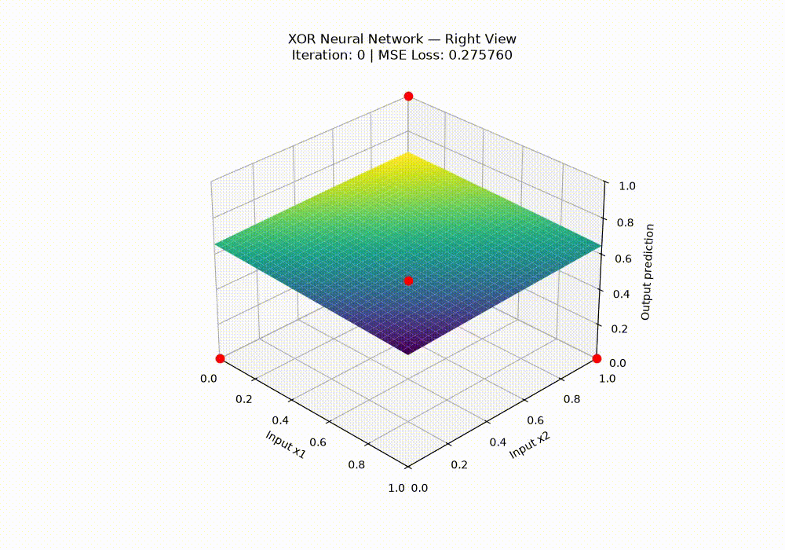

# XOR-Neural-Network
This is a 9 parameter artificial intelligence model using forward propagation, backpropagation, and gradient descent to teach the code a simple XOR logic gate.

## Features
- Custom Neural Network
- Backpropagation and gradient calculation
- Mean Squared Error Loss
- Gradient Descent
- Training animations

## Architecture
This model implements a 2-2-1 network:

- Input Layer: 2 neurons
- Hidden Layer: 2 neurons
- Output Layer: 2 neurons
- Activation Function: Sigmoid
- Loss function: Mean Squared Error
- Optimization: Gradient Descent

## XOR Logic Gate

The XOR logic gate has 4 possibilities and the 4 are not linearly separable, which is why I implemented a hidden layer.

## Activation Surface through time

## 2000 Iterations

